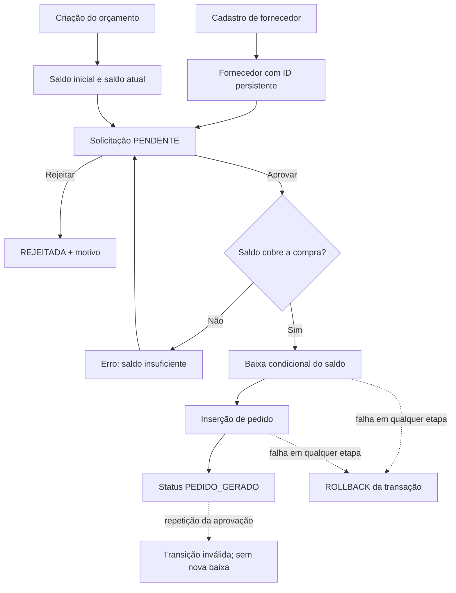

# D11 — Compras e fornecedores: fluxo, riscos e evidências

## Escopo

O módulo registra fornecedores, orçamento de compras, solicitações, decisões e pedidos. O fluxo de aprovação debita o orçamento somente quando o pedido é gerado. Os valores são persistidos como `DECIMAL(12,2)` e as tabelas usam InnoDB, necessário para que o rollback desfaça alterações intermediárias.

A migration `db/migrations/011_d11_compras.sql` é aditiva e não executa `CREATE DATABASE` nem `USE`; deve ser aplicada explicitamente ao banco selecionado. As quatro tabelas D11 também constam em `schema.sql` para instalações novas. O schema final da equipe ainda depende da consolidação dos demais números de migration por Arthur.

## Mapa do fluxo

## Estados e regras de negócio

| Estado atual | Operação | Estado resultante | Efeito no orçamento |
|---|---|---|---|
| `PENDENTE` | Aprovação válida e saldo suficiente | `PEDIDO_GERADO` | Debita uma vez, na mesma transação da geração do pedido |
| `PENDENTE` | Saldo insuficiente | `PENDENTE` | Nenhum |
| `PENDENTE` | Rejeição com motivo | `REJEITADA` | Nenhum |
| `PEDIDO_GERADO` | Nova aprovação | Rejeitada por transição inválida | Nenhum |
| `REJEITADA` | Aprovação | Rejeitada por transição inválida | Nenhum |

Regras adicionais: CNPJ é opcional; quando preenchido, é normalizado para 14 dígitos e não pode duplicar outro fornecedor. A solicitação requer descrição, solicitante, fornecedor e orçamento existentes, valor positivo e no máximo duas casas decimais. O pedido tem restrição `UNIQUE` por solicitação, além da validação de estado e do débito condicional do orçamento. A tela D11 está restrita a `ADMIN` até que a equipe confirme formalmente uma matriz mais ampla de permissões.

## Riscos e controles

| Risco | Controle implementado | Evidência reproduzível prevista |
|---|---|---|
| Duas aprovações concorrentes ou clique repetido | `SELECT ... FOR UPDATE`, mudança de estado condicional, débito condicional e unicidade do pedido | `REPETICAO_NAO_DEBITA_NEM_DUPLICA_PEDIDO` e teste de transição inválida |
| Orçamento insuficiente | Verificação do saldo e `UPDATE ... WHERE saldo_atual >= valor` | `SALDO_INSUFICIENTE_NAO_MUDA_ESTADO_SALDO_OU_PEDIDO` |
| Falha após baixar saldo e antes de concluir o pedido | Uma transação em `ComprasService.aprovar`; rollback em falha de SQL/regra | `ROLLBACK_RESTAURA_STATUS_PENDENTE`, `ROLLBACK_RESTAURA_SALDO_INTEGRAL` e `ROLLBACK_NAO_DEIXA_PEDIDO_PARCIAL` |
| Fornecedor ou orçamento inexistente | Chaves estrangeiras e validação de existência no serviço | Casos de integração e validações do serviço |
| Duplicidade de CNPJ ou pedido | Índice único de CNPJ e `UNIQUE(solicitacao_id)` | `CNPJ duplicado` e contagem de um pedido por solicitação |
| Valores monetários imprecisos | `BigDecimal` no serviço/DAO e `DECIMAL(12,2)` no banco | Casos de valor inválido e comparação exata do saldo |
| Uso de dados reais em demonstração acadêmica | Prefixo `d11it_` e dados fictícios criados e removidos pelo teste | Código de `tests/D11ComprasJdbcTest.java`; não usar fornecedores reais na demonstração |

## Tela funcional incluída

Na navegação Swing, a opção **Compras** aparece apenas para perfis autorizados pela política atual (`ADMIN`). A tela contém três áreas:

1. Cadastro de fornecedor e criação de orçamento;
2. Seleção de fornecedor/orçamento e gravação de uma solicitação pendente;
3. Consulta de solicitação, aprovação com geração de pedido ou rejeição com motivo.

As listas são recarregadas do banco por serviços/DAOs e não são mocks. Falhas de validação são apresentadas ao usuário; falhas de banco não exibem detalhes internos da conexão. O formulário depende da aplicação da migration 011 no banco usado pelo launcher.

## Execução da validação D11

1. Crie ou selecione um banco descartável cujo nome termine em `_test` e configure `AUTOBOTZ_DB_URL`, `AUTOBOTZ_DB_USER` e `AUTOBOTZ_DB_PASSWORD` somente no ambiente local.
2. Aplique somente ao banco de teste a migration `db/migrations/011_d11_compras.sql`.
3. Confirme que `AUTOBOTZ_JDBC_JAR` aponta para MariaDB Connector/J 3.5.10 (ou use o caminho padrão do README).
4. Execute `bash scripts/test-d11-compras.sh`. O script verifica a matriz de acesso desktop, recusa URL/catálogo sem sufixo `_test`, confirma as quatro tabelas e InnoDB, cobre fluxo normal, saldo insuficiente, rejeição, transição inválida, autorização e rollback no banco real.
5. Para a demonstração manual, execute `bash scripts/run.sh swing`, autentique como `ADMIN`, abra **Compras**, cadastre fornecedor e orçamento fictícios, salve uma solicitação e a aprove. Confira o ID do pedido e o novo saldo. Para provar rejeição, crie outra solicitação e rejeite-a com motivo.

O teste limpa somente registros pelos IDs criados por sua própria execução. Ele não apaga tabelas, não executa `schema.sql` e recusa bancos que não terminem em `_test`.

## Estado das evidências desta cópia

A compilação de produção pode ser validada com JDK 21. A integração JDBC requer um MariaDB de teste e o Connector/J, que não acompanham este ZIP; portanto, a existência do teste e a compilação não equivalem a uma execução de aceite. A execução JDBC e a demonstração manual devem ser anexadas ao PR depois de rodadas em ambiente `_test`. O PDF original do professor e o diretório `project-state/` não estão incluídos nesta cópia, então este relatório cobre os requisitos D11 descritos no plano de responsabilidades fornecido, sem alegar comparação documental que não pôde ser feita.
