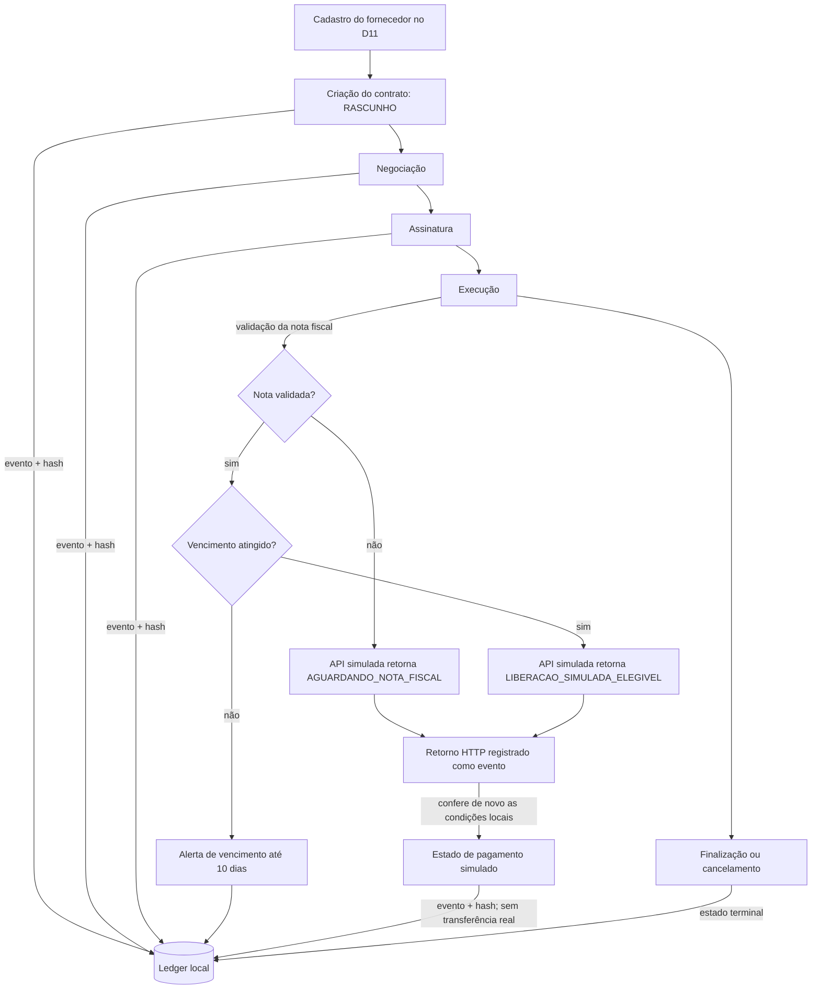

# D13 — Mapa do processo e modelo de dados

## Mapa do ciclo de vida

## Pontos de controle

| Etapa | Controle no ERP | Evidência persistida |
|---|---|---|
| Criar | fornecedor existente, valor positivo e vencimento obrigatório | evento `CONTRATO_CRIADO` |
| Negociar/assinar/executar | máquina de estados impede transição fora de ordem | evento `ESTADO_ALTERADO` |
| Validar nota | ação autorizada e validação não repetida | evento `NOTA_FISCAL_VALIDADA` |
| Vencimento | janela inclusiva de hoje a 10 dias, uma notificação por contrato | evento `ALERTA_VENCIMENTO` |
| Integrar | endpoint restrito a loopback, chave no cabeçalho, allowlist de campos | resposta e protocolo no evento `STATUS_API_SIMULADA_RECEBIDO` |
| Liberar | nota validada, vencimento atingido e contrato não terminal | evento `PAGAMENTO_SIMULADO_LIBERADO`; sem movimento financeiro |
| Auditar | validação de hash, sequência, âncora e retrato atual | resultado de integridade |

## Modelo de dados enviado à API

O request da API usa `application/x-www-form-urlencoded` e contém apenas:

| Campo | Uso | Dado pessoal? |
|---|---|---|
| `contratoId` | identificar o registro no ERP | não |
| `fornecedorId` | referenciar a contraparte pelo ID interno estável | não |
| `valor` | avaliar a regra simulada | não |
| `vencimento` | avaliar alerta e elegibilidade | não |
| `estado` | impedir ação em contrato terminal | não |
| `notaFiscalValidada` | condição de elegibilidade | não |
| `pagamentoSimuladoLiberado` | evitar duplicidade de estado | não |
| `sequenciaLedger` | identificar a versão enviada | não |
| `hashLedger` | vincular o retorno ao retrato enviado | não |

Nome, CNPJ, conta bancária e conteúdo da nota fiscal ou do contrato ficam fora da requisição simulada.

## Limites do piloto

O ledger SHA-256 é local e depende da mesma base de dados. A API usa HTTP somente em loopback para demonstração. O protocolo recebido é um recibo produzido pelo servidor simulado, sem prova criptográfica externa. Os resultados servem para demonstrar fluxo e regras em ambiente didático, não para alegar blockchain pública, imutabilidade absoluta ou pagamento executado.
